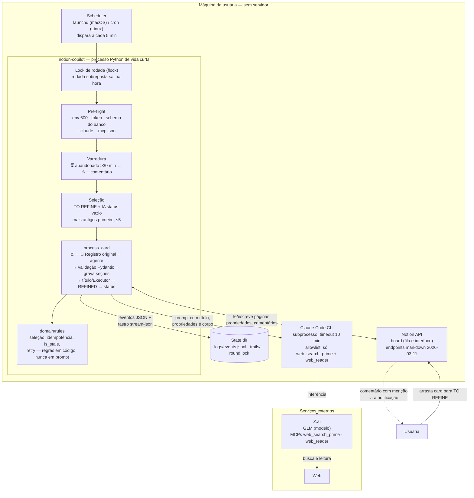

# Notion Copilot

Agente que opera um board de tarefas no Notion: a usuária captura rápido
(uma frase basta), arrasta o card para a raia **TO REFINE** e o sistema devolve
o card em **REFINED** com o registro original preservado e um refinamento
completo — contexto com fontes, links, ações sugeridas, rascunhos prontos e um
prompt de execução. Um orquestrador determinístico controla todas as escritas;
o agente (LLM) só pesquisa e escreve texto.

> Status: fatia vertical MVP implementada e validada no board real
> (feature `001-refine-happy-path` — raia To Refine, sem Plan/Execute).

## Arquitetura

Tudo roda na máquina da usuária, sem servidor. O scheduler nativo dispara um
processo Python de vida curta a cada 5 minutos (ADR-001/007); a fila é a
própria coluna TO REFINE do Notion (ADR-003); o agente é o Claude Code CLI
com o modelo GLM da Z.ai (ADR-004) e só recebe as ferramentas de busca web
(ADR-005, constituição III); toda escrita no Notion é feita pelo orquestrador
via API, nunca pelo agente (ADR-002/006).



## Pré-requisitos

- Python 3.12+ e [`uv`](https://docs.astral.sh/uv/) instalados;
- Claude Code CLI instalado e autenticado com o endpoint da Z.ai;
- Uma integração no [notion.so/my-integrations](https://www.notion.so/my-integrations)
  com as capabilities **Read content**, **Update content** e **Insert comments**
  habilitadas;
- O board do inbox compartilhado com a integração (menu `⋯` → Conexões), com
  as propriedades: `Name` (título), `Pipeline` (select), `Executor` (select),
  `IA status` (select) e `IA atualizado em` (date). Template de página **não é
  necessário** — o orquestrador cria o esqueleto da seção 🔍 (ADR-008).

## Setup

```bash
cp .env.example .env && chmod 600 .env   # preencha as credenciais
uv sync                                  # Python e dependências exatas do uv.lock
uv run notion-copilot verify             # pré-flight: tudo ✔ antes de usar
```

Variáveis do `.env`: `NOTION_TOKEN` (integração), `NOTION_DATABASE_ID` (ID do
banco do inbox — o hexadecimal de 32 caracteres na URL do board),
`NOTION_USER_ID` (você, para as menções dos comentários) e
`ANTHROPIC_AUTH_TOKEN` (chave da Z.ai; a mesma autentica o modelo e os MCPs de
busca via `${ANTHROPIC_AUTH_TOKEN}` no `.mcp.json`).

## Uso

```bash
uv run notion-copilot run            # rodada completa (o que o scheduler chama)
uv run notion-copilot run --dry-run  # lista o que faria, sem escrever nada
uv run notion-copilot run --card <page_id>  # processa só um card
uv run notion-copilot verify         # pré-flight isolado
```

Exit codes do `run`: `0` concluída (fila vazia conta como sucesso) ·
`1` pré-flight ou card inelegível · `2` rodada já em execução (lock) ·
`3` rodada terminou com cards em erro (⚠️).

Estados do card no board (propriedade IA status): vazio = elegível ·
⏳ rodando = em processamento · ❓ precisa de você = há perguntas bloqueantes
(você recebe notificação por menção em comentário) · ⚠️ erro = falha visível
com comentário; para reprocessar, devolva o card a TO REFINE e limpe o IA status.

### Agendamento a cada 5 minutos

**macOS (launchd)** — `~/Library/LaunchAgents/com.grazi.notion-copilot.plist`:

```xml
<key>ProgramArguments</key>
<array>
    <string>/caminho/absoluto/do/uv</string>
    <string>run</string>
    <string>notion-copilot</string>
    <string>run</string>
</array>
<key>WorkingDirectory</key>
<string>/caminho/absoluto/do/projeto</string>
<key>StartInterval</key>
<integer>300</integer>
```

`WorkingDirectory` é obrigatório: o launchd executa a partir de `/` e o `uv
run` precisa do `pyproject.toml` (research R4). Ativar com:

```bash
launchctl bootstrap gui/$(id -u) ~/Library/LaunchAgents/com.grazi.notion-copilot.plist
```

**Linux (cron)** — `crontab -e`:

```
*/5 * * * * cd /caminho/do/projeto && /caminho/do/uv run notion-copilot run
```

Rodadas sobrepostas são inofensivas: o lock faz a nova rodada terminar na
hora, e a seleção nunca pega card em ⏳.

## Onde ficam os registros

Diretório de estado (via `platformdirs`; no macOS,
`~/Library/Application Support/notion-copilot/`): `logs/events.jsonl` (um
evento JSON por passo — `ts`, `run_id`, `card_id`, `stage`, `event`),
`trails/<run_id>/` (rastro `stream-json` completo de cada execução do agente)
e `round.lock`. Nenhum segredo em nenhum log (RNF-O5). A pergunta "o que a IA
fez com cada card?" se responde com o board + esse diretório (SC-005).

## Desenvolvimento

```bash
uv run pytest          # núcleo com fakes dos ports — sem rede, sem Notion, sem modelo
uv run ruff check .    # lint
uv run mypy src        # tipos (domain e application em modo strict)
```

Estrutura: `src/notion_copilot/domain` (regras puras, zero IO) →
`application` (ports + orquestração) → `adapters` (Notion API, Claude CLI,
arquivos) → `cli`. Prompts versionados em `prompts/` (constituição IX).

## Documentação

- [Design Doc](docs/notion-copilot-design-doc.md)
- [ADRs](docs/notion-copilot-adrs.md) — 8 decisões, todas com status e consequências
- [Specs](specs/) — fonte da verdade por feature (`001-refine-happy-path`)
- [Quickstart de validação](specs/001-refine-happy-path/quickstart.md)
