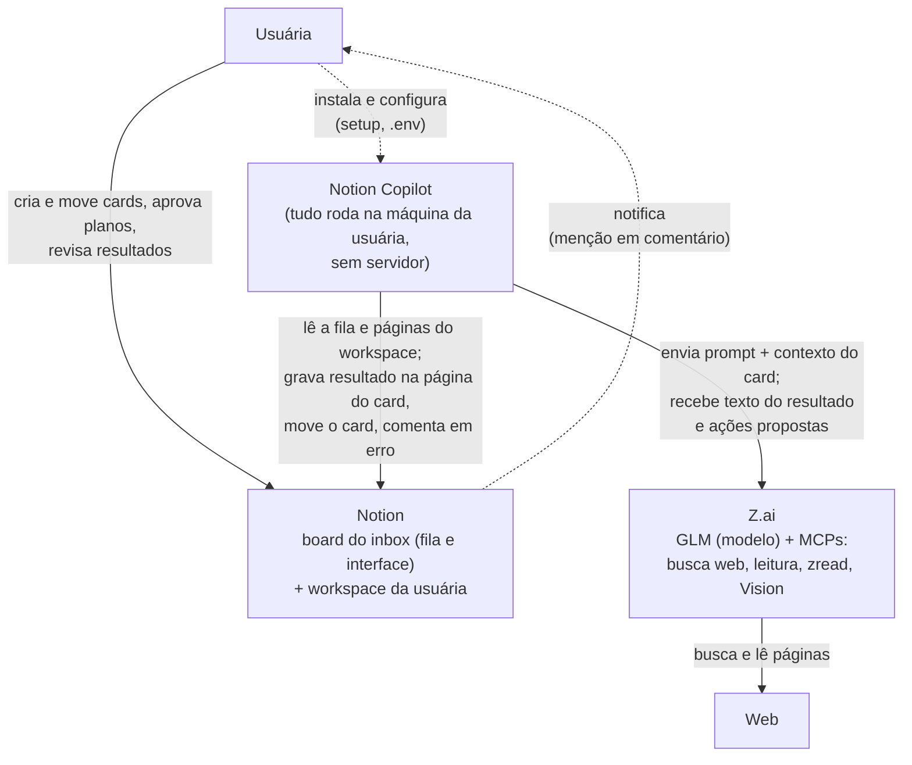
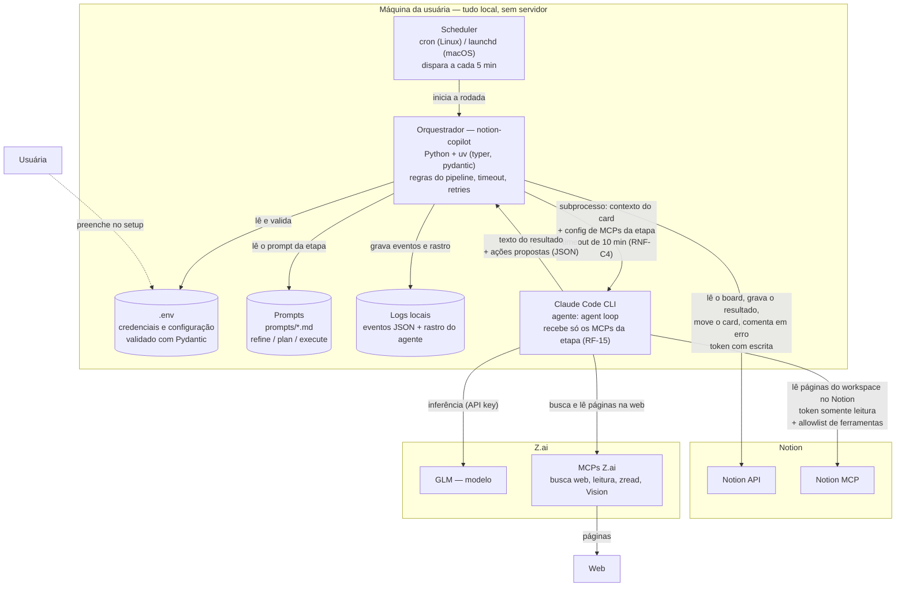

# Notion Copilot — Design Doc

**Autor(es):** Grazi

**Revisores:** —

**Data:** 2026-10-05

**Status:** draft

## 1. Overview

[Resumo de 2-3 parágrafos legível por qualquer engenheiro da empresa.]

## 2. Contexto

[Qual problema estamos resolvendo, por que é necessário, como se encaixa na estratégia.]

## 3. Goals e Non-Goals

### 3.1 Goals

#### Funcionais — o que o sistema faz

- **RF-1.** O orquestrador DEVE iniciar uma rodada a cada 5 minutos que seleciona os cards nas raias To Refine, Plan e AI execute.
- **RF-2.** O orquestrador DEVE processar, por rodada, no máximo 5 cards somando as três raias, um card por vez.
- **RF-3.** O agente DEVE produzir como texto o resultado da etapa da raia do card (refinar, planejar ou executar), usando o prompt definido para aquela etapa.
- **RF-4.** O orquestrador DEVE gravar o texto do resultado na página do próprio card (regra de escrita na seção 4.1).
- **RF-5.** O orquestrador DEVE mover o card para a raia seguinte após gravar o resultado (PRD, seções 6 e 8).
- **RF-6.** O agente PODE pesquisar na web usando o MCP de busca da Z.ai.
- **RF-7.** O agente PODE ler o conteúdo de páginas web usando o MCP de leitura da Z.ai.
- **RF-8.** O agente PODE ler páginas do workspace pelo Notion MCP, somente com ferramentas de leitura. Primeiras páginas liberadas: Empregabilidade e Resource library.
- **RF-9.** Para criar ou editar páginas fora do card, o agente DEVE apenas propor a ação; quem executa é o orquestrador (seção 4.1). Deletar fica fora da v2.
- **RF-10.** O orquestrador DEVE executar as ações propostas pelo agente na etapa Execute.
- **RF-11.** O orquestrador DEVE exigir aprovação prévia da usuária — declarada no Plano — antes de criar página em outro banco ou editar página fora do inbox (PRD, seções 7.3 e 7.4).
- **RF-12.** (a avaliar) O agente DEVE ler imagens anexadas à página do card. Candidato: Vision MCP da Z.ai (análise de imagem e OCR, incluído no GLM Coding Plan). Entra na v2.
- **RF-13.** Quando uma execução falha ou o agente precisa de uma resposta, o orquestrador DEVE preencher a propriedade IA status com ⚠️ erro ou ❓ precisa de você.
- **RF-14.** O orquestrador DEVE deixar um comentário na página do card mencionando a usuária — o que gera notificação do Notion — sempre que o IA status for ⚠️ ou ❓.
- **RF-15.** Cada etapa DEVE receber somente os servidores MCP de que precisa, por arquivo de configuração entregue ao Claude Code (seção 4.1).
- **RF-16.** Adicionar um MCP novo no futuro (GitHub, Figma, email) NÃO DEVE exigir reescrita do restante do sistema.
- **RF-17.** Uma instaladora DEVE conseguir instalar e executar o sistema no próprio computador e workspace seguindo apenas o README, sem ajuda da autora.
- **RF-18.** A instaladora DEVE usar as próprias credenciais via `.env` e configurar o modelo com a própria API key (PRD, seção 3.2).

#### Não-funcionais — como o sistema faz

**Confiabilidade**

- **RNF-C1.** Processar o mesmo card duas vezes NÃO DEVE criar uma segunda seção 🔍/🗺️/✅ nem página duplicada em outro banco. *(Teste: reprocessar um card e comparar.)*
- **RNF-C2.** Enquanto uma rodada estiver em execução, o agendador NÃO DEVE iniciar a rodada seguinte. *(Por quê: duas rodadas simultâneas podem pegar o mesmo card.)*
- **RNF-C3.** Um erro em um card DEVE marcar somente esse card como ⚠️ erro; a rodada DEVE continuar com os demais cards.
- **RNF-C4.** Cada execução do agente DEVE terminar em até 10 minutos (timeout). *(Por quê: o agent loop pode repetir sem fim e gastar tokens.)*
- **RNF-C5.** Falhas temporárias (queda de rede, erro 429) DEVEM receber até 2 novas tentativas com espera crescente (backoff); esgotadas as tentativas, o card DEVE virar ⚠️ erro.
- **RNF-C6.** Um card em ⏳ rodando há mais de 30 minutos DEVE ser marcado ⚠️ erro na rodada seguinte (card abandonado por processo interrompido).

**Observabilidade**

- **RNF-O1.** Cada evento DEVE ser registrado como uma linha JSON contendo horário, `run_id`, `card_id`, etapa, evento e duração. *(Por quê: JSON filtra com `jq`; texto livre, não.)*
- **RNF-O2.** Todos os eventos de uma rodada DEVEM compartilhar o mesmo `run_id`; todos os eventos de um card, o mesmo `card_id`.
- **RNF-O3.** Cada execução DEVE salvar em arquivo todas as chamadas de ferramenta do agente e seus retornos (saída `--output-format stream-json` do Claude Code).
- **RNF-O4.** O comentário de erro previsto no RF-13/RF-14 DEVE incluir o `run_id` da execução que falhou.
- **RNF-O5.** Nenhum log DEVE conter API key ou token do Notion.
- **RNF-O6.** Logs DEVEM ser apagados após 30 dias.

**Segurança e governança**

- **RNF-S1.** Cada etapa DEVE receber somente as ferramentas de que precisa. Nenhuma etapa DEVE receber ferramenta de escrita no Notion. O token do Notion DEVE dar acesso apenas às páginas liberadas (inbox, Empregabilidade, Resource library).
- **RNF-S2.** Nenhuma ferramenta disponível ao agente DEVE ser capaz de apagar ou arquivar — garantia de configuração e código, não de prompt (o orquestrador não implementa ação de apagar nem arquivar).
- **RNF-S3.** Antes do Execute, o código Python DEVE verificar se o plano foi aprovado quando a tabela 7.3 do PRD exige aprovação. Quem decide é o código, nunca o agente.
- **RNF-S4.** O prompt DEVE instruir o agente a tratar texto de sites e páginas como informação, nunca como ordem. *(Se desobedecer, S1 e S2 limitam o dano.)*
- **RNF-S5.** Toda escrita fora do card DEVE ser registrada no log com `run_id`, `card_id`, página alterada e tipo de ação. *(Teste: responder "o que o agente mudou no workspace na semana passada?" só com logs.)*
- **RNF-S6.** Credenciais DEVEM ficar somente no `.env` (raiz do projeto, permissão 600, listado no `.gitignore`; o repositório traz `.env.example` sem valores). A API key do modelo DEVE ser passada somente ao processo `claude` iniciado pelo programa, nunca como variável global. Variável de ambiente tem precedência sobre o `.env`. *(Por quê arquivo, não shell profile/cofre: cron e launchd não leem o perfil; cofres Linux dependem de sessão gráfica.)*


**Manutenibilidade**

- **RNF-M1.** O código DEVE ficar em camadas com dependências apontando apenas para o núcleo; o núcleo (regras do pipeline) NÃO DEVE importar nada de Notion, Claude Code ou `.env`.
- **RNF-M2.** Cada pasta DEVE corresponder a uma camada documentada nas seções 4 e 5. *(Teste: alguém que nunca viu o código descobre onde mudar algo lendo só essas seções.)*
- **RNF-M3.** Testes automatizados são obrigatórios apenas para: regra de aprovação (RNF-S3), idempotência (RNF-C1) e transição de raias — e DEVEM rodar sem acessar Notion nem modelo (o que também comprova RNF-M1).
- **RNF-M4.** O prompt de cada etapa DEVE ficar em arquivo versionado (ex.: `prompts/refine.md`), nunca como texto dentro do Python. *(Por quê: mudar comportamento sem mexer no código, com histórico no git.)*
- **RNF-M5.** Adicionar uma etapa nova DEVE exigir somente um arquivo de prompt e uma linha na tabela de etapas, sem alterar o loop principal. Adicionar um MCP novo DEVE exigir somente configuração (RF-16).
- **RNF-M6.** O código da v2 NÃO DEVE repetir nenhum problema do catálogo "Red flags — análise de 03/10/2026 (GLM)".

**Portabilidade**

- **RNF-P1.** O sistema DEVE rodar em macOS e Linux, incluindo o agendamento a cada 5 minutos (mecanismo na seção 4). Windows fica fora da v2, e o README DEVE informar.
- **RNF-P2.** `uv sync` DEVE instalar a versão exata do Python e as dependências do `uv.lock`; o programa DEVE rodar com `uv run notion-copilot`.
- **RNF-P3.** Os pré-requisitos obrigatórios DEVEM se limitar a: `uv`, Claude Code CLI (instalador nativo, sem Node.js), uma integração do Notion e a API key do modelo. Node.js é necessário somente para o Vision MCP.
- **RNF-P4.** Sem Node.js instalado, o sistema DEVE funcionar com a capacidade `image_read` desligada e um aviso no log (degradação graciosa).
- **RNF-P5.** `notion-copilot setup` DEVE criar um banco novo com as propriedades do pipeline. Num banco existente, DEVE adicionar somente as propriedades que faltam, sem alterar as existentes. O mesmo comando DEVE criar o `.env` a partir do `.env.example`, com permissão 600.
- **RNF-P6.** Toda rodada DEVE validar, antes de processar: `.env`, propriedades do banco e presença do comando `claude`. O token do Notion DEVE ser validado com `GET /users/me` (não gasta tokens do modelo); a API key do modelo é conferida somente quanto à presença. Se faltar algo, o programa DEVE parar com mensagem dizendo o que falta e como corrigir.

**Custo** — sem requisito na v2; RNF-C4 e RF-2 limitam o consumo de tokens.

### 3.2 Non-Goals

1. **Nenhuma operação destrutiva**: o agente nunca apaga nada. Permanece assim na v2 inteira.
2. **MCPs além do Notion e busca**: GitHub, email, Figma ficam para depois da v2.
3. **Processamento de vídeo e PDF**: links e anexos de vídeo e PDF ficam guardados como estão; o conteúdo não é analisado. Imagem está a avaliar (RF-12).
4. **Multiusuário / multiworkspace como serviço**: cada pessoa que clona roda a própria instância, na própria máquina e workspace.
5. **Infraestrutura de fila ou mensageria**: sem Celery, Redis, broker. A coluna do Notion é a fila.
6. **Daemon ou endpoint público**: sem processo 24/7, sem webhooks, sem servidor na nuvem.
7. **Runtime de agente próprio**: usamos o Claude Code CLI.
8. **Migração de código da v1**: reescrita do zero. A v1 fornece apenas o exemplo-ouro (qualidade de saída) e a configuração comprovada (MCP Z.ai).
9. **Serviços pagos**: nada além dos tokens do plano atual.
10. **Interface gráfica própria**: o board do Notion é a interface.
11. **Movimentação automática por idade**: o sistema não promove cards por envelhecerem; prioridade é decisão da usuária.

## 

## 4. System Architecture

- Componentes principais e responsabilidades
    - **Usuária** → move cards, aprova planos, revisa resultados
    - **Scheduler (cron/launchd)** → dispara uma rodada a cada 5 min
    - **Orquestrador (`notion-copilot`)** → parte determinística: lê o board, aplica as regras, chama o agente, grava o resultado, move o card, escreve os logs
    - **Claude Code CLI** → agente: executa o agent loop
    - **GLM (via Z.ai)** → modelo: interpreta e escreve
    - **MCPs remotos da Z.ai** → busca web, leitura de páginas, zread, **Vision MCP**
    - **Notion MCP** → leitura do workspace pelo agente: token de uma integração sem capability de escrita + allowlist de ferramentas na chamada do Claude Code. O agente propõe ações em JSON; quem escreve é o orquestrador (seção 4.1)
    - **Notion API** → o orquestrador lê e escreve no board
    - **Pydantic** → valida o `.env` e as ações em JSON que o agente propõe
    - **Prompts** → instruções de cada etapa (são arquivos, não executam)
    - **Logs locais** → registro das rodadas e rastro do agente

- Diagrama de arquitetura

**Nível 1 — Context (C4):** o sistema como uma única caixa preta, quem o usa e com quais sistemas externos ele fala. Neste nível não entra tecnologia: *como* cada acesso acontece (API REST, MCP, subprocesso, cron) é assunto do Nível 2.

**Atores e sistemas externos:**

| Ator / Sistema | Papel no contexto |
| --- | --- |
| **Usuária** | Usa o board do Notion como interface: cria e move cards entre raias, aprova planos, revisa resultados. Também instala e opera o sistema na própria máquina, com as próprias credenciais (RF-17, RF-18). |
| **Notion** | Guarda a fila (raias do board do inbox), as páginas dos cards e o workspace que o agente pode ler (Empregabilidade, Resource library). É também o canal de retorno: comentário com menção vira notificação para a usuária (RF-14). |
| **Z.ai** | Provedor externo do modelo (GLM) e dos MCPs de busca web, leitura de páginas, zread e Vision. Recebe prompt + contexto do card e devolve o texto do resultado e as ações propostas. |
| **Web** | Conteúdo que o agente busca e lê através dos MCPs da Z.ai. |



**Nível 2 — Container (C4):** os blocos executáveis e depósitos de dados. Nota: em C4 estrito, cron e arquivos ficariam fora da fronteira do sistema; aqui a fronteira é a máquina da usuária, porque o ponto central da arquitetura é que tudo roda local, sem servidor.



- Fluxo de dados principal
- Estrutura de pastas

```
src/notion_copilot/
  domain/            # Regras do pipeline. Zero IO. Não conhece Notion nem Claude.
    models.py          # Card, Stage, ProposedAction, IAStatus (⏳/⚠️/❓)
    stages.py          # Tabela de etapas (fonte única do conhecimento por etapa)
    rules.py           # Transição de raia, aprovação (RNF-S3), idempotência (RNF-C1)
  application/
    ports.py           # Protocols: NotionReader, NotionWriter, AgentRunner, Clock
    run_round.py       # A rodada: lock, verificação, loop de cards
    process_card.py    # Ciclo de vida de um card: ⏳ → agente → validar → escrever → mover
  adapters/
    notion_api.py      # Único arquivo que sabe o que é um "block" do Notion
    claude_cli.py      # Único arquivo que sabe o que é stream-json e as flags do CLI
    prompts_fs.py      # Carrega prompts/*.md
  cli.py             # typer: run | setup | verify
  config.py          # pydantic-settings (.env)
prompts/              # refine.md, plan.md, execute.md (RNF-M4)
tests/                # Testes da RNF-M3, contra fakes dos ports
```

Estilo: hexagonal (Ports and Adapters — o núcleo declara interfaces, as camadas externas implementam). Regra de dependência: `adapters` e `cli` importam `domain` e `application`; `domain` não importa nada de fora. Teste prático: `domain/` é compreensível sem saber que Notion e Claude Code existem.

## 5. Detailed Design

Cada subseção abaixo detalha um módulo do processo Python `notion-copilot`. O diagrama C4 Nível 3 (componentes internos) entra na subseção do módulo. O Nível 4 (código) fica de fora: os arquivos já estão na árvore da seção 4.

No C4 Nível 2, o container chamado **Orquestrador** é o processo Python inteiro (`cli` + `application` + `domain` + `adapters`). Esta seção 5.1 cobre só a camada de coordenação: `application/`.

### 5.1 Orquestrador (`application/`)

O orquestrador coordena uma **rodada** (uma execução disparada pelo scheduler) e o ciclo de um **card** (uma página-tarefa no board do inbox). Ele pergunta as regras para `domain/` e pede leitura, escrita e execução do agente pelos **ports** (interfaces que `application/` declara e os adapters implementam).

### 5.2 Component B
...

## 8. Security & Compliance

- Autenticação/autorização
- Proteção de dados
- Ameaças e mitigação

## 9. Performance & Scalability

- Carga esperada
- Caching, otimizações, estratégia de scaling

## 10. Testing Strategy

- Unit, integration, E2E
- Critérios de aceitação

## 11. Rollout Plan

- Feature flags, migração, compatibilidade
- Cronograma de marcos

## 12. Dependencies, Risks & Open Questions

- Dependências externas
- Riscos e mitigação
- Questões em aberto

## 13. References

[Links para PRD, issues, docs relacionados]

## 14. Changelog

- v0.2 – 2026-10-10 – Grazi (revisão) – Seção 5.1: invariante do comentário (RF-14 em `needs_you` pós-agente); `run_round` com `try/finally` no lock; modo card único especificado (bypass da seleção, sem varredura, `card_not_eligible`); regra dos 30 min movida para `domain/rules.py` (`is_stale`); RNF-P6 dividida entre `cli.py` (`.env`) e preflight via ports; `decision.next_lane` no contrato `commit_success`; rastro `stream-json` (RNF-O3) explícito no contrato do `AgentRunner`; tabela de testes ampliada (7 casos novos); nomenclatura padronizada ("preflight").
- v0.1 – Data – Autor – Mudanças
