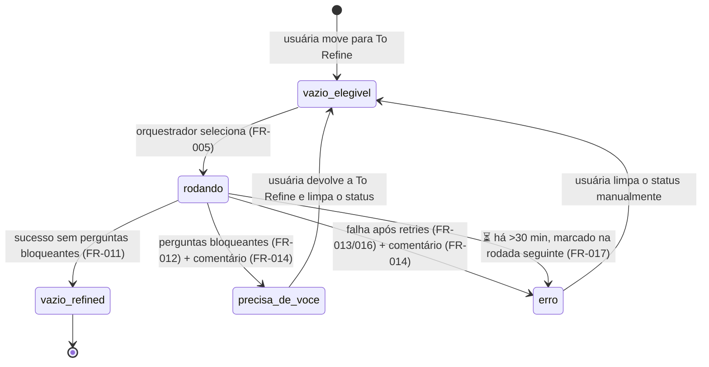

# Data Model — Refine Happy Path (Phase 1)

O estado de verdade vive no **Notion** (board do inbox) — não há banco local. Este documento descreve as entidades como o código as enxerga (`domain/models.py`, Pydantic), suas validações (derivadas dos FRs) e transições de estado.

---

## Entidades

### Card

Uma página-tarefa no board do inbox.

| Campo | Tipo | Origem | Regras |
|---|---|---|---|
| `page_id` | UUID | Notion | Identificador; usado em logs e comentários |
| `title` | str | Notion (prop. Title "Name") | Texto exato da captura; alvo da reescrita (FR-007, FR-009) |
| `pipeline` | `Pipeline` | Notion (select) | Só `TO_REFINE` é elegível (FR-004) |
| `executor` | `Executor \| None` | Notion (select) | Preenchível pelo refinamento (sugestão) |
| `ia_status` | `IAStatus` | Notion (select) | Vazio = elegível; ⏳/❓/⚠️ ver máquina abaixo |
| `ia_updated_at` | `datetime \| None` | Notion (date "IA atualizado em") | Base da regra dos 30 min (FR-017) |
| `created_at` | datetime | Notion | Ordenação da fila (mais antigos primeiro) |
| `body_markdown` | str | Notion (blocks da página) | Entregue ao agente no prompt (FR-007); normalizado pelo adapter |
| `has_refinement` / `has_original_record` | bool | Derivados do markdown da página (R9) | Idempotência (FR-015, R9): 📝 existente → não recria; seção já preenchida → não reescreve |

Validação de seleção (FR-004/FR-005): `pipeline == TO_REFINE` **e** `ia_status == vazio`. ⚠️ e ❓ reentram só por ação manual da usuária (spec, clarificação 2026-10-10).

### Rodada (Run)

| Campo | Tipo | Regras |
|---|---|---|
| `run_id` | str (ex.: `20261010T1425-7f3a`) | Único; citado em logs e comentários (FR-014) |
| `started_at` / `finished_at` | datetime | Duração em cada evento (RNF-O1) |
| `selected` | list[Card] | ≤ 5, mais antigos primeiro (FR-004) |
| `results` | list[CardResult] | Uma das terminações por card (FR-018) |

Invariante (FR-018): ao fim da rodada, nenhum card selecionado fica em ⏳ — cada card termina em um dos desfechos de `CardResult` acima (`success`, `needs_you`, `error`, `skipped_moved`, `skipped_already_refined`; os desfechos `skipped_*` também limpam o ⏳), exceto rodada interrompida, coberta por FR-017.

### CardResult

| Campo | Tipo |
|---|---|
| `card_id` | UUID |
| `outcome` | `success \| needs_you \| error \| skipped_moved \| skipped_already_refined` |
| `error_kind` | `str \| None` (timeout, agent_invalid_json, notion_api, …) |
| `attempts` | int (1–3, FR-016) |
| `duration_s` | float |

### Refinement (saída validada do agente — ver `contracts/agent-output.md`)

A página do card nasce com o esqueleto da seção `## 🔍 Refinamento` (template do banco — research R1); o Refinement é o preenchimento dos corpos das seções.

| Campo | Tipo | Regras |
|---|---|---|
| `title` | str (≤ 80 chars) | Título curto e claro (FR-010); pode igualar o original |
| `sections` | dict com 7 chaves (`contexto` … `executor_sugerido`) | Corpos das seções do template, **sem headings** (contrato do agente); preenchidos um a um via `update_content` (FR-010) |
| `blocking_questions` | list[str] | Não vazio → card termina ❓ (FR-012, R11) |
| `executor_suggestion` | `HUMANO \| IA` | Alimenta a propriedade Executor (só se vier vazia); o texto exibido na seção vem de `sections.executor_sugerido` |

Validação Pydantic na fronteira (constituição, Workflow): JSON fora do schema = erro permanente (sem retry, R8); fato sem fonte deve estar marcado como Hipótese — regra de contrato do prompt, auditável por inspeção (SC-004).

### Registro original (bloco imutável)

- Criado **antes** de qualquer reescrita de título (FR-006).
- Conteúdo: texto exato da captura (título original + corpo original em markdown).
- Nunca editado depois; segunda execução não o recria nem o altera (FR-015).
- Posicionado antes da seção `## 🔍 Refinamento` na página.

---

## Máquina de estados — IA status

Invariante de auditoria: toda transição de `IA status` reescreve a propriedade `IA atualizado em` — é dela que FR-017 computa os 30 minutos (`is_stale` em `domain/rules.py`).

Transições implementadas em `domain/rules.py` (constituição I — nunca em prompt). Quem grava qualquer transição é o orquestrador via `NotionWriter` (FR-009).

## Eventos de log (RNF-O1/O2)

Cada evento é uma linha JSON: `ts`, `run_id`, `card_id?`, `stage` (`preflight|select|refine|write|move|comment`), `event`, `duration_s?`, `detail?`. Nenhum campo pode conter segredo (RNF-O5). Rastro completo do agente (`stream-json`) salvo por execução em arquivo próprio referenciado pelo `run_id` (RNF-O3).
